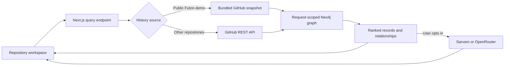

# SkillForge

**Understand why a codebase changed, even after the engineer who made the change has moved on.**

A new maintainer opens Futon and finds that the reader waits for chapter updates by default. Was that deliberate? SkillForge can trace the earlier opt-in setting in PR #112 to the later change in PR #146, show the file where the preference disappeared, and open both original discussions. That same workflow helps an incoming engineer take over a private service or a developer study a public project before contributing. [Earlier PR](https://github.com/AppFuton/Futon/pull/112) · [Later PR](https://github.com/AppFuton/Futon/pull/146)

[Quick start](#quick-start) · [Demo questions](#try-three-questions) · [Private access](#private-team-handover) · [Graph and AI](#how-an-answer-is-built) · [API](#query-api) · [Testing](#testing) · [Deployment](#deploying-on-render)

## Repository graph

Open **Graph** and index a GitHub repository URL or a local folder. SkillForge stores each index in Neo4j and shows three ways to explore it:

- **File structure** shows folders, their parent, and their contents.
- **Module imports** shows statically detected imports between JavaScript and TypeScript files and external packages. It samples up to 18 source files and recognizes relative imports and conventional `@/` paths. Runtime calls and custom compiler aliases can be missing.
- **Decision history** shows recent pull requests, commits, commit parents, and explicit references between them. Use **Superseded decisions only** to see explicit replacement declarations from merged PRs.
- **Decision conflicts** pairs a later merged pull request with the earlier PR it names. Each pair shows available authors, merge dates, the original PR text, and links to both records. The detector looks for explicit replacement language or a stated change to the default, behavior, approach, or architecture alongside a PR reference. It does not infer conflicts from similar wording alone.

Choose a node, search by name or path, and zoom the diagram. GitHub nodes link to their source. Private repositories require sign-in and a scoped read token. Local folder indexing also requires sign-in. It sends file paths and detected imports, skips common build folders and environment files, and leaves GitHub history to the GitHub importer. On public deployments, set `APP_ORIGIN` to the public HTTPS origin so robots and sitemap metadata point to the correct host.

## Quick start

Use Node.js 24, npm and a running Neo4j instance. Docker is convenient for the local database. Run the following in a POSIX shell on a fresh checkout.

```sh
git clone https://github.com/tanmayyyyayyy/NEW-HACKFRONT.git
cd NEW-HACKFRONT
npm ci
cp .env.example .env.local
```

Set these two entries in `.env.local`. Generate the secret with `openssl rand -base64 48`. The origin must match the address you open in the browser, including its port.

```dotenv
APP_ORIGIN=http://localhost:3000
BETTER_AUTH_SECRET=<paste-your-generated-secret>
```

Start Neo4j with the local-only credentials from the example environment, then start Next.js. If you already have Neo4j or AuraDB, set the connection variables to that database and skip the Docker command.

```sh
docker run -d --name skillforge-neo4j \
  -p 127.0.0.1:7687:7687 \
  -e NEO4J_AUTH=neo4j/whygraph-local \
  neo4j:5.26.27-community
npm start
```

Keep the local server running while you edit. Both `npm start` and `npm run dev` enable Fast Refresh on save. To preview a production build locally, run `npm run build` followed by `npm run start:prod`.

Open [localhost:3000](http://localhost:3000) and choose **Try a real decision** to see a guided trace. The trace is available without an account, Neo4j, or an AI provider. Choose **Run this question in the workspace** and submit it to query the bundled Futon snapshot through Neo4j. Sarvam, OAuth, mail delivery and the offline extraction pipeline are optional for this walkthrough. Check database connectivity at [the health endpoint](http://localhost:3000/api/health).

## Try three questions

| Ask in the Futon workspace | What to inspect |
| --- | --- |
| Why preserve reading statistics during migration? Trace issue #127 and PR #138. | Open the user's report and the linked fix. Identify the reporter and the PR author. |
| Why did PR #146 replace the chapter update behavior from PR #112? | Inspect the override timeline, its recorded basis, and the GitHub diff. Repeat with a cutoff of 1 October 2026 to inspect the earlier record. |
| Why does Futon use Kubernetes for billing? | The sampled history supplies insufficient evidence. The UI reports the gap. |

Use **Ask a follow-up** to ask “Who recorded this, and when?” about the selected answer. Follow-ups carry source IDs back to the server for fresh retrieval. Typing an explicit PR number changes the lookup. Use the main question box for an independent question. The workspace keeps the six most recent turns in tab memory and can export a cited trail as plain text.

## Private team handover

1. A manager grants the engineer read access to the repository in GitHub. The engineer creates their own fine-grained personal access token for the selected repository with read access to metadata, contents, issues and pull requests. Some organizations require token approval.
2. Under **Workspace access → Private team handover**, enter `owner/repository` and the token. SkillForge checks both the GitHub user and the repository's private status before creating a session bound to the user's numeric GitHub ID.
3. Ask a question or cite a PR number. The server checks repository access again for each question and follow-up. A revoked grant blocks subsequent reads. The engineer can open each citation in GitHub to inspect the original record.

The token flow works without registering a GitHub OAuth app. Google, GitHub OAuth and verified email are additional sign-in options. Users who sign in through those methods still supply a repository-scoped GitHub token for private history. GitHub manages repository membership and revocation. [Token sign-in implementation](lib/github-token-signin.ts) · [Account configuration](lib/auth.ts)

## How an answer is built



**1. Collect a bounded sample.** Live retrieval requests up to 20 recently updated closed PRs, 20 issue-list entries and 12 recent commits. Up to three referenced threads can trigger further requests for comments and, for PRs, changed file paths. The Futon demo uses its bundled snapshot and can also trace captured changes to Android preference keys. Coverage varies with the question and source. [History collector and graph query](lib/repository-chat.ts)

**2. Connect the records.** A temporary `SkillForgeChatRun` node owns the evidence records for one request. The graph uses three kinds of historical relationship.

| Relationship | Meaning |
| --- | --- |
| `REFERENCES` | A record mentions another issue or PR in the sample. |
| `DISCUSSION` | A comment belongs to the selected thread. |
| `SUPERSEDES` | A later record explicitly replaces an earlier one, or the Futon preference history shows a later PR removing a key an earlier PR added at the same path. |

**3. Retrieve the trail.** Parameterized Cypher prioritizes explicit issue or PR references. Without a reference, the query requires at least two overlapping search terms and a minimum weighted score. It returns up to five records with up to eight related entries per record. The UI shows the match basis, sampled record count, source links and retrieval query. The match basis describes how the source was found. It does not measure the probability that an explanation is true. The transaction rolls back after retrieval, so the database user needs write access even for the demo.

**4. Explain with consent.** If the user checks **Let AI explain the evidence**, the server can send the question and selected evidence to Sarvam for an English, Hindi or Hinglish explanation. If Sarvam fails and OpenRouter is configured, the server tries the same evidence there. The UI names the provider that answered and keeps GitHub sources available when both fail. Empty retrieval skips both providers. The browser can also dictate questions and read prompts or explanations aloud when its speech services support them. [Query and model boundary](app/api/ask/route.ts)

### Where the evidence stops

GitHub history can establish what someone wrote, which files changed and when two recorded decisions conflict. A PR author may differ from the person who chose the design. An undocumented conversation or a loosely worded reversal may leave no detectable relationship. A date cutoff includes a sampled PR from its opening date and marks it merged once its merge date falls within the cutoff. Descriptions and changed-file lists still reflect the retrieved version. Use explicit PR numbers, code identifiers or English search terms for the most reliable retrieval. Multilingual generation applies to the explanation.

## Query API

From a second terminal, run a public query against the local development server. Use the exact configured origin.

```sh
curl -sS http://localhost:3000/api/ask \
  -H 'Origin: http://localhost:3000' \
  -H 'Content-Type: application/json' \
  --data '{"repo":"AppFuton/Futon","mode":"public","question":"Why did #146 replace #112?","language":"English","sarvam":false}'
```

| Request field | Contract |
| --- | --- |
| `repo`, `mode` | GitHub repository name or URL and either `public` or `private`. |
| `question`, `language` | A 3–500 character question and one of `English`, `Hindi` or `Hinglish`. |
| `contextIds` | Optional list of up to five source IDs from a prior answer. Explicit references in the question take precedence. |
| `throughDate`, `sarvam` | Optional ISO date cutoff and optional model consent flag. Consent defaults to false. |

The response includes `evidence[].record`, relationship entries in `evidence[].links`, `recordCount`, `matchBasis`, `query`, and an optional `summary`. An empty evidence array is a valid result. Private calls require both a signed-in session and the engineer's bearer token. The route checks request origin, caps the body at 8 KiB and returns `Cache-Control: no-store`.

## Configuration and storage

| Setting | Purpose |
| --- | --- |
| `APP_ORIGIN`, `BETTER_AUTH_SECRET` | Exact browser origin and a stable, high-entropy secret of at least 32 characters for account operations. |
| `NEO4J_URI`, `NEO4J_USERNAME`, `NEO4J_PASSWORD`, `NEO4J_DATABASE` | Graph connection. Use the authenticated TLS URI for a hosted database. The database name defaults to `neo4j`. |
| `ACCOUNT_DATABASE` | SQLite file for account data and sessions. Defaults to `.local/accounts.sqlite`. Use a persistent writable volume on the host. |
| `GITHUB_PUBLIC_READ_TOKEN` | Optional server-side token for live public history. Use a dedicated GitHub account with read access only to public repositories. Public results can be reused for up to two minutes per process. Private queries use the engineer's own token and check GitHub on every request. |
| `SARVAM_API_KEY` | Optional server-side key for consented explanations. Restart the server after changing it. |
| `OPEN_ROUTER_API_KEY` | Optional server-side fallback key. Uses `openai/gpt-4.1-mini` through OpenRouter when Sarvam cannot produce an explanation. |
| `GITHUB_CLIENT_ID`, `GITHUB_CLIENT_SECRET` | Optional GitHub OAuth credentials. Register the callback at `<APP_ORIGIN>/api/auth/callback/github`. |
| `GOOGLE_CLIENT_ID`, `GOOGLE_CLIENT_SECRET` | Optional Google OAuth credentials. Register `<APP_ORIGIN>/api/auth/callback/google`. |
| `RESEND_API_KEY`, `EMAIL_FROM` | Optional verified sender for signup verification and password recovery. |

Private GitHub personal tokens stay in tab memory and travel to the SkillForge server for authorized GitHub requests. Reloading the page requires re-entry. Query graphs are temporary. A downloaded trail is a separate local file containing the exported evidence. Review the organization's data-sharing policy before enabling hosted AI for private records. [Example environment](.env.example) · [Private credential handoff](app/private-transfer.ts)

## Developer map

| Start here | What to change |
| --- | --- |
| [Repository workspace](app/RepositoryChat.tsx) | Question composer, model consent, date filters, follow-ups and history. |
| [Evidence trail](app/EvidenceTrail.tsx) | Override timeline and cited text export. |
| [Workspace entry](app/workspace/page.tsx) and [account choices](app/account/AccountForm.tsx) | Guest entry, team handover and sign-in navigation. |
| [Repository retrieval](lib/repository-chat.ts) | GitHub sampling, evidence shape, graph relationships and bounded Cypher. |
| [Ask endpoint](app/api/ask/route.ts) | Request validation, authorization, provider prompt and failure handling. |
| [Trace library](app/collections.ts) | Curated examples. Check each example against the bundled source and an actual query. |
| [Graph tests](scripts/check-chat.ts) and [browser tests](scripts/check-ui.mjs) | Source-level regression assertions and end-to-end product journeys. |

When extending retrieval, add a case with a known source and a case with insufficient evidence. Changes to private retrieval should also exercise revoked access. Keep evidence selection on the server and render untrusted repository text as text. If a change sends new fields to a hosted model, update the consent copy alongside the request.

### Offline prototype tools

The repository also contains the original Futon research pipeline. `npm run collect` refreshes the snapshot and optionally uses `GITHUB_TOKEN`. `npm run extract` uses `GEMINI_API_KEY` and optional `GEMINI_MODEL` for offline decision extraction. **Run `npm run load` only against a dedicated disposable database** because it deletes existing nodes labeled `WhyGraph` before loading. The current web chatbot builds its own temporary graph at request time. [Collector](scripts/collect.ts) · [Extractor](scripts/extract.ts) · [Graph loader](scripts/load.ts)

## Testing

With the quick-start database running, build the production app and run the query and account tests. The explicit env-file loads your Neo4j connection for the test process.

```sh
npm run build
npx tsx --env-file=.env.local scripts/check-chat.ts
```

The chat suite uses real Neo4j transactions, a temporary SQLite account store and controlled GitHub, mail and Sarvam responses. It checks citations, supersession, cutoff dates, abstention, private sign-in, revoked access, model consent and transaction rollback.

With the app running at port 3000, run the Chromium walkthrough at desktop and mobile widths.

```sh
npx playwright install chromium
TEST_ORIGIN=http://localhost:3000 npm run check:ui
```

Live OAuth callbacks, real email delivery, organization token approval and Sarvam output quality need staging checks with the corresponding providers.

## Deploying on Render

The root Blueprint provisions a **free web service**. The Docker image runs Next.js as the `node` user and stores accounts in `.local/accounts.sqlite`. Render can discard that file on redeploy or restart. For durable accounts, use a plan with a persistent disk and set `ACCOUNT_DATABASE` to a path on that disk. [Render Blueprint](render.yaml) · [Dockerfile](Dockerfile)

1. Connect this repository as a Blueprint and select the root `render.yaml`.
2. Set the exact HTTPS origin and Neo4j credentials. Render generates the account secret. Keep it stable across deployments.
3. Add the optional provider keys you intend to use and register OAuth callbacks against the deployed origin. Set `GITHUB_PUBLIC_READ_TOKEN` in the web service environment to raise the limit for live public history.
4. Open `/api/health` and check that `neo4j` is `connected`. The endpoint can report the service ready while the database is disconnected. Then run the three public demo questions, a private sign-in and a revoked-access check. A healthy graph alone does not verify login, mail or AI delivery.

This configuration targets a single application instance. SQLite needs durable storage and backups. The process-local query budget allows six concurrent queries and 90 starts per minute. A multi-instance rollout needs a shared account store and coordinated limits. [Query budget](lib/query-budget.ts)

## Troubleshooting

| Symptom | First check |
| --- | --- |
| Request origin could not be verified | Use the scheme and port configured in `APP_ORIGIN`. For a local origin, the app accepts `localhost`, `127.0.0.1`, and `[::1]` on that port. Hosted origins must match exactly. Restart after changing the environment. |
| Public demo loads but queries fail | Check `/api/health`, the Neo4j database name, credentials and write permission for temporary projections. |
| GitHub denies a private repository | Verify the engineer's repository membership, selected token repository, read permissions, expiry and organization approval. |
| Evidence appears without an AI explanation | Check consent, server-side keys and provider availability. Confirm that the query returned evidence. |
| A known decision is missing | Try its PR or issue number, check the cutoff and inspect the sampled record count. Large repositories have bounded coverage. |
